# LMS Master Specification

**Status:** Proposed  
**Date:** 2026-11-24  
**Scope:** V1 LMS for Shiksha International  
**Decision:** Build a thin custom LMS inside the existing NestJS + Next.js monolith. Buy video streaming, DRM, and live class infrastructure. Do not run Moodle, Open edX, or Canvas as the core.

**Supersedes:** Conflicting or incomplete LMS drafts in this folder, including:
- `lms-architecture-overview.md`
- `LMS_COMPLETE_TECHNICAL_SPEC.md`
- `LMS_TECHNICAL_SPEC.md`
- `lms-integration-spec.md`
- `lms-integration-spec-orchestration.md`
- `lms-orchestration-plan.md`
- `lms-api-endpoints.md`
- `lms-mandatory-features.md`
- `lms-agent-roles.md`
- `LMS-INTEGRATION-QUESTIONS.md`
- `docs/02-architecture/edTech_v1.md`

Those documents remain useful as research. This document is the implementation source of truth.

---

## 1. Decision Summary

| Decision | Choice | Reason |
|---|---|---|
| LMS core | Custom NestJS modules + Next.js UI | Reuses auth, users, students, payments, admin, notifications, audit |
| Moodle | No for core | PHP/MySQL, separate auth/users, plugin ops, poor Udemy-like UX, payment and admission sync overhead |
| Open edX | No | Heavy Python/Kubernetes/MongoDB/Redis/Celery stack, MOOC-oriented, overkill for V1 |
| Canvas LMS | No | Enterprise Rails application, heavy operations, poor fit |
| Managed LMS platforms | No for core | Lock-in, weak admission integration, still cannot prevent recording |
| Video | Managed provider: Cloudflare Stream or Mux | Adaptive HLS, signed playback, CDN, no transcoding ops |
| Live classes | LiveKit Cloud or Agora | Managed WebRTC, recording, attendance webhooks |
| PDF and markdown | Private R2 + application rendering | Reuses existing storage, no public bucket |
| Payments | Existing PayU integration with new course order flow | Actual code uses PayU, not Razorpay |
| Course authoring | Admin-only in V1, optional `INSTRUCTOR` later | Avoids role and payout complexity |
| Marketplace | No in V1 | No instructor payouts, revenue splits, KYC, refunds |
| Mobile | Responsive PWA first | Native apps and offline downloads are separate projects |
| Offline downloads | No in V1 | Conflicts with anti-download requirement |

**Security reality:** No web platform can guarantee that a user cannot download, screen record, or externally capture content. The goal is to stop casual downloading and link sharing, raise the cost of piracy, trace leaks, and keep honest users honest. DRM plus signed playback plus watermarking is the strongest practical web posture. It is not absolute.

---

## 2. Scope

### 2.1 Goals

- Sell and deliver recorded courses.
- Deliver PDF and markdown lessons.
- Run live classes for enrolled students.
- Publish recordings of live classes as on-demand lessons.
- Track lesson and course progress.
- Run simple quizzes and issue certificates.
- Support paid courses, free courses, and stage-gated orientation courses.
- Give admins a complete course authoring and publishing workflow.
- Keep paid video and PDF content private.
- Reuse existing auth, users, students, payments, notifications, and audit logs.
- Keep V1 as a modular monolith.

### 2.2 Non-goals

- SCORM or xAPI runtime.
- Full gradebook.
- Assignments with manual grading.
- Instructor marketplace and payouts.
- Multi-tenant white-label LMS.
- Native iOS or Android apps.
- Offline video downloads.
- Social learning, cohorts chat, leaderboards.
- AI tutoring or automatic content generation.
- Proctored course exams. The existing admission exam module remains separate.
- Perfect anti-recording.

### 2.3 Assumptions

- Content is company-owned or licensed by Shiksha International.
- Admins create and publish courses in V1.
- External instructors are optional and can be added later with an `INSTRUCTOR` role.
- Course prices are in INR and stored in paise.
- PayU remains the payment provider.
- Cloudflare R2 remains the private object store.
- The existing student application stages remain unchanged.
- Video and live providers are external managed services.
- V1 launches on web only.

### 2.4 Open Decisions

| Decision | Default | Needed before |
|---|---|---|
| Video provider | Cloudflare Stream | Phase 2 |
| Live provider | LiveKit Cloud | Phase 3 |
| DRM budget | Start without DRM, add if piracy justifies | Phase 2 |
| Paid vs free mix | Both: paid prep, free stage-gated orientation | Phase 1 |
| Instructor role | Admin-only authoring | Phase 1 |
| SCORM requirement | None | Phase 1 |
| Offline requirement | None | Post V1 |

---

## 3. Current Repository State

### 3.1 What Exists

| Area | Current state | Implication |
|---|---|---|
| LMS docs | Many drafts and research documents | Useful input, not build-ready |
| `PlatformCourse` schema | `apps/api/prisma/schema/platform-course.prisma` | Unused by any service or UI |
| Legacy `Course` schema | `apps/api/prisma/schema/course.prisma` | University course catalog, not LMS |
| `Section` schema | `apps/api/prisma/schema/section.prisma` | No relation to `PlatformCourse`, not usable as curriculum |
| Courses module | `apps/api/src/modules/courses` | Legacy CRUD, not registered in `AppModule` |
| Sections module | `apps/api/src/modules/sections` | Legacy CRUD, not registered in `AppModule` |
| Auth | JWT, refresh tokens, guards, roles | Reusable |
| Roles | `SUPER_ADMIN`, `ADMIN`, `STUDENT`, `PARENT` | No `INSTRUCTOR` |
| Payments | PayU stage payments | Reusable helpers, separate course order flow needed |
| Storage | Private R2 with signed URLs | Reusable for PDFs, images, markdown assets |
| Upload API | 55MB limit, buffers file in API | Not suitable for lecture video |
| Exams | Admission entrance exam module with proctoring | Not a course quiz engine |
| Notifications | Email, SMS, push infrastructure | Reusable |
| Audit | `AuditLog` model and admin audit patterns | Reusable |
| Redis | Cache, rate limiting, idempotency patterns | Reusable |

### 3.2 Known Gaps

- No lesson, video, progress, quiz, live, attendance, certificate, order, or review models.
- No LMS API module registered.
- No instructor role.
- No course purchase flow.
- No direct-to-provider video upload.
- No video playback authorization.
- No live class integration.
- No UI for catalog, learning, or authoring.
- No tests for LMS access control.
- Existing docs disagree on provider, payment gateway, roles, and deployment model.

### 3.3 Reuse Map

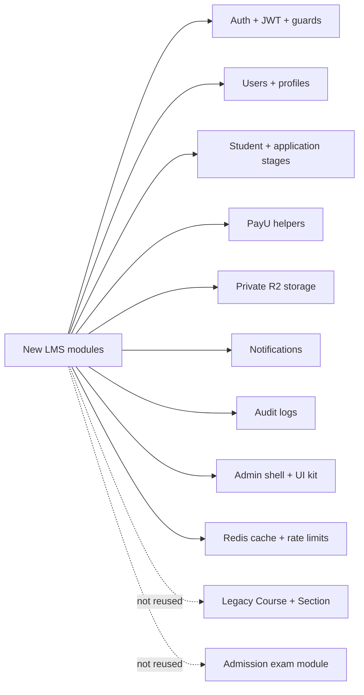

---

## 4. Architecture

### 4.1 System Context

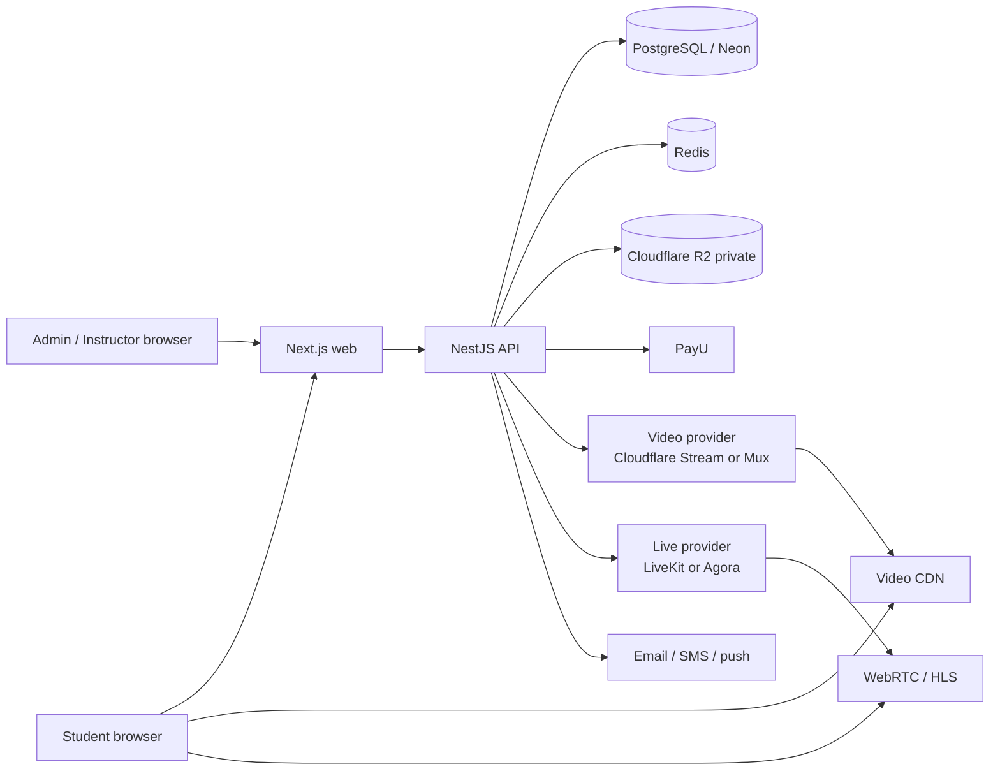

### 4.2 Module Diagram

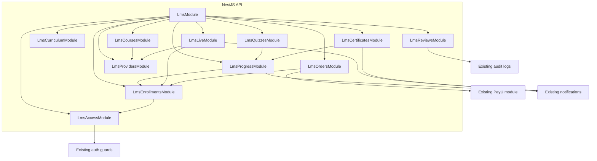

### 4.3 Deployment

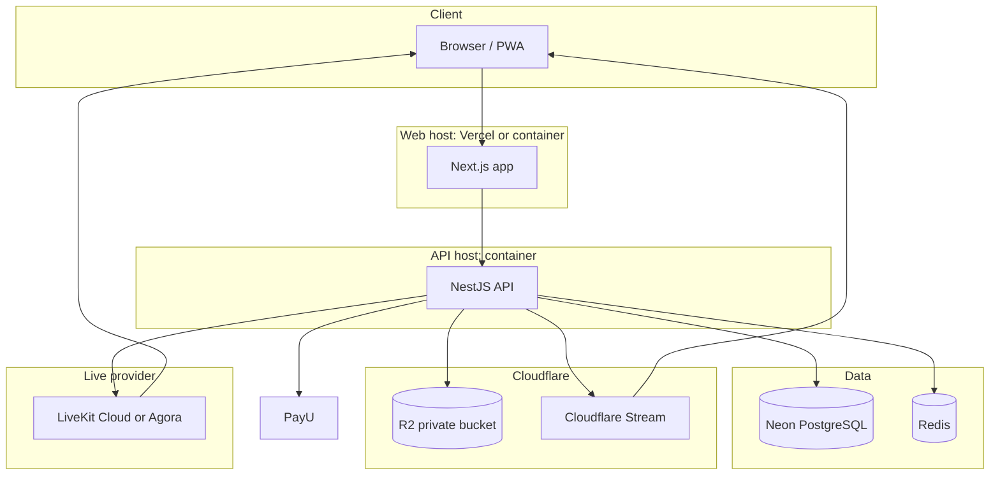

### 4.4 Provider Adapters

Do not call provider SDKs directly from controllers or services. Put them behind adapters so a provider can be replaced without rewriting the LMS.

| Adapter | Methods | Notes |
|---|---|---|
| `VideoProvider` | `createDirectUpload`, `getAsset`, `createPlaybackToken`, `deleteAsset`, `verifyWebhook` | Cloudflare Stream, Mux, Vimeo |
| `LiveProvider` | `createRoom`, `createJoinToken`, `startRecording`, `stopRecording`, `verifyWebhook`, `getRecording` | LiveKit, Agora |
| `PaymentProvider` | `createOrder`, `verifyCallback`, `refund` | Existing PayU helpers wrapped behind adapter |
| `StorageProvider` | `getSignedUrl`, `putObject`, `deleteObject` | Existing R2 service |

---

## 5. Roles and Permissions

### 5.1 Role Model

| Role | Purpose | V1 |
|---|---|---|
| `SUPER_ADMIN` | Full platform control, provider settings, role management | Yes |
| `ADMIN` | LMS management, publish courses, refunds, moderation | Yes |
| `INSTRUCTOR` | Author and manage own courses, view own students | Optional |
| `STUDENT` | Buy, enroll, learn, take quizzes, earn certificates | Yes |
| `PARENT` | View linked student progress | No, later |

If external faculty will author content, add `INSTRUCTOR` to the existing `Role` enum. Do not overload `ADMIN` for faculty. If V1 is admin-authored only, skip the role migration.

### 5.2 Permission Matrix

| Action | Student | Instructor | Admin | Super Admin |
|---|---|---|---|---|
| Browse published courses | Yes | Yes | Yes | Yes |
| View preview lessons | Yes | Yes | Yes | Yes |
| Purchase course | Yes | Yes | Yes | Yes |
| Access enrolled lessons | Yes | Own courses | Yes | Yes |
| Track progress | Own | Own | Any | Any |
| Take quiz | Enrolled | Own preview | Any | Any |
| Download certificate | Own | Own | Any | Any |
| Create course | No | Yes | Yes | Yes |
| Edit course | No | Own only | Any | Any |
| Publish course | No | No, submit only | Yes | Yes |
| Upload video | No | Own course | Yes | Yes |
| Schedule live class | No | Own course | Yes | Yes |
| Start or end live class | No | Own session | Yes | Yes |
| View course students | No | Own course | Any | Any |
| Grant enrollment | No | No | Yes | Yes |
| Refund order | No | No | Yes | Yes |
| Moderate review | No | No | Yes | Yes |
| Manage providers and secrets | No | No | No | Yes |

---

## 6. Domain Model

### 6.1 Core Concepts

- **Course:** the sellable product and content container.
- **Batch:** an optional scheduled offering of a course. Used for live cohorts and access windows.
- **Module:** a chapter or section inside a course.
- **Lesson:** the smallest learning unit. Types: video, PDF, markdown, quiz, live session, recording.
- **Enrollment:** a user's right to access a course or batch.
- **Order:** a payment attempt for a course or batch.
- **Progress:** per-lesson watch and completion state.
- **Quiz:** a lesson-level assessment with questions and attempts.
- **Live session:** a scheduled real-time class with attendance and optional recording.
- **Certificate:** a verifiable completion record.
- **Review:** a student rating and comment after enrollment.

Do not reuse the legacy `Course` or `Section` models. Use `Lms*` models to avoid collisions.

### 6.2 Entity Relationship Diagram

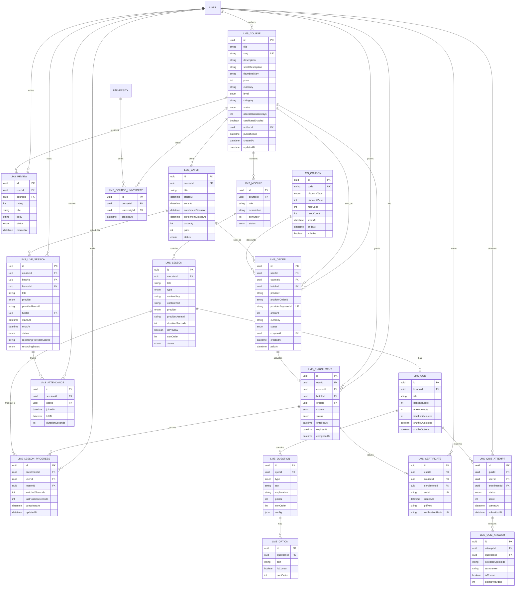

### 6.3 Proposed Prisma Schema

Add these models in `apps/api/prisma/schema/lms.prisma`. Add the relation fields to the existing `User` and `University` models.

```prisma
// ============================================
// LMS Schema
// ============================================

model LmsCourse {
  id                  String          @id @default(uuid())
  title               String
  slug                String          @unique
  description         String          @db.Text
  smallDescription    String
  thumbnailKey        String?
  trailerAssetId      String?
  price               Int             @default(0) // paise
  currency            String          @default("INR")
  level               LmsCourseLevel  @default(BEGINNER)
  category            String
  status              LmsCourseStatus @default(DRAFT)
  accessDurationDays  Int?            // null = lifetime
  certificateEnabled  Boolean         @default(true)
  authorId            String
  publishedAt         DateTime?
  createdAt           DateTime        @default(now())
  updatedAt           DateTime        @updatedAt

  author        User                 @relation("LmsCourseAuthor", fields: [authorId], references: [id], onDelete: Restrict)
  modules       LmsModule[]
  batches       LmsBatch[]
  enrollments   LmsEnrollment[]
  liveSessions  LmsLiveSession[]
  reviews       LmsReview[]
  orders        LmsOrder[]
  universities  LmsCourseUniversity[]

  @@index([status, publishedAt])
  @@index([category, level])
  @@index([authorId])
  @@map("lms_courses")
}

model LmsBatch {
  id                  String          @id @default(uuid())
  courseId            String
  title               String
  startsAt            DateTime?
  endsAt              DateTime?
  enrollmentOpensAt   DateTime?
  enrollmentClosesAt  DateTime?
  capacity            Int?
  price               Int?            // paise, overrides course price
  status              LmsBatchStatus  @default(OPEN)
  createdAt           DateTime        @default(now())

  course        LmsCourse         @relation(fields: [courseId], references: [id], onDelete: Cascade)
  enrollments   LmsEnrollment[]
  liveSessions  LmsLiveSession[]
  orders        LmsOrder[]

  @@index([courseId, status])
  @@map("lms_batches")
}

model LmsModule {
  id          String           @id @default(uuid())
  courseId    String
  title       String
  description String?
  sortOrder   Int
  status      LmsModuleStatus  @default(ACTIVE)
  createdAt   DateTime         @default(now())
  updatedAt   DateTime         @updatedAt

  course   LmsCourse   @relation(fields: [courseId], references: [id], onDelete: Cascade)
  lessons  LmsLesson[]

  @@unique([courseId, sortOrder])
  @@index([courseId])
  @@map("lms_modules")
}

model LmsLesson {
  id               String             @id @default(uuid())
  moduleId         String
  title            String
  type             LmsLessonType
  contentKey       String?            // R2 key for PDF or markdown asset
  contentText      String?            @db.Text // markdown body
  provider         LmsContentProvider?
  providerAssetId  String?            // video or recording asset
  durationSeconds  Int?
  isPreview        Boolean            @default(false)
  sortOrder        Int
  status           LmsLessonStatus    @default(ACTIVE)
  createdAt        DateTime           @default(now())
  updatedAt        DateTime           @updatedAt

  module        LmsModule           @relation(fields: [moduleId], references: [id], onDelete: Cascade)
  progress      LmsLessonProgress[]
  quiz          LmsQuiz?
  liveSessions  LmsLiveSession[]

  @@unique([moduleId, sortOrder])
  @@index([moduleId])
  @@index([type])
  @@map("lms_lessons")
}

model LmsEnrollment {
  id          String               @id @default(uuid())
  userId      String
  courseId    String
  batchId     String?
  orderId     String?              @unique
  source      LmsEnrollmentSource
  status      LmsEnrollmentStatus  @default(PENDING)
  enrolledAt  DateTime             @default(now())
  expiresAt   DateTime?
  completedAt DateTime?
  createdAt   DateTime             @default(now())
  updatedAt   DateTime             @updatedAt

  user        User                 @relation(fields: [userId], references: [id], onDelete: Cascade)
  course      LmsCourse            @relation(fields: [courseId], references: [id], onDelete: Cascade)
  batch       LmsBatch?            @relation(fields: [batchId], references: [id], onDelete: SetNull)
  order       LmsOrder?            @relation(fields: [orderId], references: [id], onDelete: SetNull)
  progress    LmsLessonProgress[]
  attempts    LmsQuizAttempt[]
  certificate LmsCertificate?

  @@unique([userId, courseId])
  @@index([courseId, status])
  @@index([batchId])
  @@map("lms_enrollments")
}

model LmsLessonProgress {
  id                 String    @id @default(uuid())
  enrollmentId       String
  userId             String
  lessonId           String
  watchedSeconds     Int       @default(0)
  lastPositionSeconds Int      @default(0)
  completedAt        DateTime?
  updatedAt          DateTime  @updatedAt

  enrollment LmsEnrollment @relation(fields: [enrollmentId], references: [id], onDelete: Cascade)
  user       User          @relation(fields: [userId], references: [id], onDelete: Cascade)
  lesson     LmsLesson     @relation(fields: [lessonId], references: [id], onDelete: Cascade)

  @@unique([enrollmentId, lessonId])
  @@index([userId, lessonId])
  @@map("lms_lesson_progress")
}

model LmsQuiz {
  id               String   @id @default(uuid())
  lessonId         String   @unique
  title            String
  description      String?
  passingScore     Int      @default(70)
  maxAttempts      Int      @default(3)
  timeLimitMinutes Int?
  shuffleQuestions Boolean  @default(true)
  shuffleOptions   Boolean  @default(true)
  createdAt        DateTime @default(now())
  updatedAt        DateTime @updatedAt

  lesson    LmsLesson        @relation(fields: [lessonId], references: [id], onDelete: Cascade)
  questions LmsQuestion[]
  attempts  LmsQuizAttempt[]

  @@map("lms_quizzes")
}

model LmsQuestion {
  id          String          @id @default(uuid())
  quizId      String
  type        LmsQuestionType
  text        String          @db.Text
  explanation String?         @db.Text
  points      Int             @default(1)
  sortOrder   Int
  config      Json?
  createdAt   DateTime        @default(now())

  quiz    LmsQuiz        @relation(fields: [quizId], references: [id], onDelete: Cascade)
  options LmsOption[]
  answers LmsQuizAnswer[]

  @@unique([quizId, sortOrder])
  @@index([quizId])
  @@map("lms_questions")
}

model LmsOption {
  id         String @id @default(uuid())
  questionId String
  text       String @db.Text
  isCorrect  Boolean @default(false)
  sortOrder  Int

  question LmsQuestion @relation(fields: [questionId], references: [id], onDelete: Cascade)

  @@unique([questionId, sortOrder])
  @@index([questionId])
  @@map("lms_options")
}

model LmsQuizAttempt {
  id           String                @id @default(uuid())
  quizId       String
  userId       String
  enrollmentId String
  status       LmsQuizAttemptStatus  @default(IN_PROGRESS)
  score        Int?
  startedAt    DateTime              @default(now())
  submittedAt  DateTime?

  quiz       LmsQuiz       @relation(fields: [quizId], references: [id], onDelete: Cascade)
  user       User          @relation(fields: [userId], references: [id], onDelete: Cascade)
  enrollment LmsEnrollment @relation(fields: [enrollmentId], references: [id], onDelete: Cascade)
  answers    LmsQuizAnswer[]

  @@index([quizId, userId])
  @@index([enrollmentId])
  @@map("lms_quiz_attempts")
}

model LmsQuizAnswer {
  id                String  @id @default(uuid())
  attemptId         String
  questionId        String
  selectedOptionIds String[] @default([])
  textAnswer        String? @db.Text
  isCorrect         Boolean?
  pointsAwarded     Int     @default(0)

  attempt  LmsQuizAttempt @relation(fields: [attemptId], references: [id], onDelete: Cascade)
  question LmsQuestion    @relation(fields: [questionId], references: [id], onDelete: Cascade)

  @@unique([attemptId, questionId])
  @@map("lms_quiz_answers")
}

model LmsLiveSession {
  id                         String              @id @default(uuid())
  courseId                   String
  batchId                    String?
  lessonId                   String?
  title                      String
  description                String?
  provider                   LmsLiveProvider
  providerRoomId             String
  hostId                     String
  startsAt                   DateTime
  endsAt                     DateTime?
  status                     LmsLiveStatus       @default(SCHEDULED)
  recordingProviderAssetId   String?
  recordingStatus            LmsRecordingStatus  @default(NONE)
  createdAt                  DateTime            @default(now())
  updatedAt                  DateTime            @updatedAt

  course     LmsCourse        @relation(fields: [courseId], references: [id], onDelete: Cascade)
  batch      LmsBatch?        @relation(fields: [batchId], references: [id], onDelete: SetNull)
  lesson     LmsLesson?       @relation(fields: [lessonId], references: [id], onDelete: SetNull)
  host       User             @relation("LmsLiveHost", fields: [hostId], references: [id], onDelete: Restrict)
  attendance LmsAttendance[]

  @@index([courseId, startsAt])
  @@index([batchId, startsAt])
  @@index([status])
  @@map("lms_live_sessions")
}

model LmsAttendance {
  id              String    @id @default(uuid())
  sessionId       String
  userId          String
  joinedAt        DateTime  @default(now())
  leftAt          DateTime?
  durationSeconds Int       @default(0)

  session LmsLiveSession @relation(fields: [sessionId], references: [id], onDelete: Cascade)
  user    User           @relation(fields: [userId], references: [id], onDelete: Cascade)

  @@unique([sessionId, userId])
  @@index([userId])
  @@map("lms_attendance")
}

model LmsCertificate {
  id               String   @id @default(uuid())
  userId           String
  courseId         String
  enrollmentId     String   @unique
  serial           String   @unique
  issuedAt         DateTime @default(now())
  pdfKey           String
  verificationHash String   @unique

  user       User          @relation(fields: [userId], references: [id], onDelete: Restrict)
  course     LmsCourse     @relation(fields: [courseId], references: [id], onDelete: Restrict)
  enrollment LmsEnrollment @relation(fields: [enrollmentId], references: [id], onDelete: Cascade)

  @@index([userId])
  @@map("lms_certificates")
}

model LmsReview {
  id        String          @id @default(uuid())
  userId    String
  courseId  String
  rating    Int
  title     String?
  body      String?         @db.Text
  status    LmsReviewStatus @default(PENDING)
  createdAt DateTime        @default(now())
  updatedAt DateTime        @updatedAt

  user   User      @relation(fields: [userId], references: [id], onDelete: Cascade)
  course LmsCourse @relation(fields: [courseId], references: [id], onDelete: Cascade)

  @@unique([userId, courseId])
  @@index([courseId, status])
  @@map("lms_reviews")
}

model LmsOrder {
  id                String          @id @default(uuid())
  userId            String
  courseId          String
  batchId           String?
  provider          String          @default("PAYU")
  providerOrderId   String?
  providerPaymentId String?         @unique
  amount            Int             // paise
  currency          String          @default("INR")
  status            LmsOrderStatus  @default(CREATED)
  couponId          String?
  createdAt         DateTime        @default(now())
  paidAt            DateTime?

  user       User           @relation(fields: [userId], references: [id], onDelete: Restrict)
  course     LmsCourse      @relation(fields: [courseId], references: [id], onDelete: Restrict)
  batch      LmsBatch?      @relation(fields: [batchId], references: [id], onDelete: SetNull)
  coupon     LmsCoupon?     @relation(fields: [couponId], references: [id], onDelete: SetNull)
  enrollment LmsEnrollment?

  @@index([userId, status])
  @@index([courseId, status])
  @@map("lms_orders")
}

model LmsCoupon {
  id            String          @id @default(uuid())
  code          String          @unique
  discountType  LmsDiscountType
  discountValue Int
  maxUses       Int?
  usedCount     Int             @default(0)
  startsAt      DateTime?
  endsAt        DateTime?
  isActive      Boolean         @default(true)

  orders LmsOrder[]

  @@map("lms_coupons")
}

model LmsCourseUniversity {
  id           String   @id @default(uuid())
  courseId     String
  universityId String
  createdAt    DateTime @default(now())

  course     LmsCourse  @relation(fields: [courseId], references: [id], onDelete: Cascade)
  university University @relation(fields: [universityId], references: [id], onDelete: Cascade)

  @@unique([courseId, universityId])
  @@index([universityId])
  @@map("lms_course_universities")
}

enum LmsCourseLevel {
  BEGINNER
  INTERMEDIATE
  ADVANCED
  EXPERT
}

enum LmsCourseStatus {
  DRAFT
  IN_REVIEW
  PUBLISHED
  ARCHIVED
}

enum LmsModuleStatus {
  ACTIVE
  INACTIVE
}

enum LmsLessonType {
  VIDEO
  PDF
  MARKDOWN
  QUIZ
  LIVE
  RECORDING
}

enum LmsLessonStatus {
  ACTIVE
  INACTIVE
}

enum LmsEnrollmentSource {
  PURCHASE
  FREE
  STAGE_UNLOCK
  ADMIN_GRANT
}

enum LmsEnrollmentStatus {
  PENDING
  ACTIVE
  EXPIRED
  COMPLETED
  CANCELLED
}

enum LmsOrderStatus {
  CREATED
  PENDING
  PAID
  FAILED
  REFUNDED
}

enum LmsQuestionType {
  SINGLE_CHOICE
  MULTIPLE_CHOICE
  TRUE_FALSE
  SHORT_TEXT
}

enum LmsQuizAttemptStatus {
  IN_PROGRESS
  SUBMITTED
  GRADED
  EXPIRED
}

enum LmsLiveProvider {
  LIVEKIT
  AGORA
}

enum LmsLiveStatus {
  SCHEDULED
  LIVE
  ENDED
  CANCELLED
}

enum LmsRecordingStatus {
  NONE
  PROCESSING
  READY
  FAILED
}

enum LmsReviewStatus {
  PENDING
  APPROVED
  REJECTED
}

enum LmsContentProvider {
  CLOUDFLARE_STREAM
  MUX
  VIMEO
  R2
}

enum LmsDiscountType {
  PERCENT
  FIXED
}

enum LmsBatchStatus {
  OPEN
  CLOSED
  RUNNING
  COMPLETED
  CANCELLED
}
```

Add to the existing `User` model:

```prisma
model User {
  // existing fields

  lmsAuthoredCourses     LmsCourse[]         @relation("LmsCourseAuthor")
  lmsEnrollments         LmsEnrollment[]
  lmsLessonProgress      LmsLessonProgress[]
  lmsQuizAttempts        LmsQuizAttempt[]
  lmsCertificates        LmsCertificate[]
  lmsLiveAttendance      LmsAttendance[]
  lmsHostedLiveSessions  LmsLiveSession[]     @relation("LmsLiveHost")
  lmsReviews             LmsReview[]
  lmsOrders              LmsOrder[]
}
```

Add to the existing `University` model:

```prisma
model University {
  // existing fields

  lmsCourseLinks LmsCourseUniversity[]
}
```

### 6.4 Constraints and Indexes

| Constraint | Reason |
|---|---|
| `LmsCourse.slug` unique | Stable public URL |
| `LmsModule(courseId, sortOrder)` unique | Deterministic curriculum order |
| `LmsLesson(moduleId, sortOrder)` unique | Deterministic lesson order |
| `LmsEnrollment(userId, courseId)` unique | One enrollment per course per user |
| `LmsLessonProgress(enrollmentId, lessonId)` unique | One progress row per lesson |
| `LmsQuiz.lessonId` unique | One quiz per lesson in V1 |
| `LmsQuizAttempt` index on `(quizId, userId)` | Attempt lookup |
| `LmsCertificate.serial` unique | Public verification |
| `LmsCertificate.verificationHash` unique | Tamper detection |
| `LmsOrder.providerPaymentId` unique | Payment idempotency |
| `LmsReview(userId, courseId)` unique | One review per student per course |
| `LmsCourseUniversity(courseId, universityId)` unique | No duplicate links |

Add database checks or service validation for:
- `LmsReview.rating` between 1 and 5.
- `LmsOrder.amount` greater than or equal to zero.
- `LmsQuiz.passingScore` between 0 and 100.
- `LmsLesson.durationSeconds` greater than or equal to zero.
- `LmsBatch.capacity` greater than zero when set.

### 6.5 Migration Notes

1. Do not extend the legacy `Course` or `Section` models for LMS.
2. Add `Lms*` models in a new `apps/api/prisma/schema/lms.prisma`.
3. Add the `User` and `University` relation fields.
4. Add `INSTRUCTOR` to `Role` only if external faculty will author courses.
5. Leave `PlatformCourse` untouched until migration is confirmed, then drop or rename it.
6. Keep the legacy `Course` and `Section` tables if the university catalog still uses them. Otherwise archive them.
7. Register `LmsModule` in `apps/api/src/app.module.ts`. The existing `CoursesModule` and `SectionsModule` are not registered.
8. Add a feature flag `LMS_ENABLED` for staged rollout.
9. Seed one draft course, one module, one video lesson, one PDF lesson, one markdown lesson, and one quiz for smoke testing.

---

## 7. Content and Access Model

### 7.1 Course vs Batch

Use a batch when the course has live classes, a fixed schedule, or a limited access window. Use no batch for self-paced recorded courses.

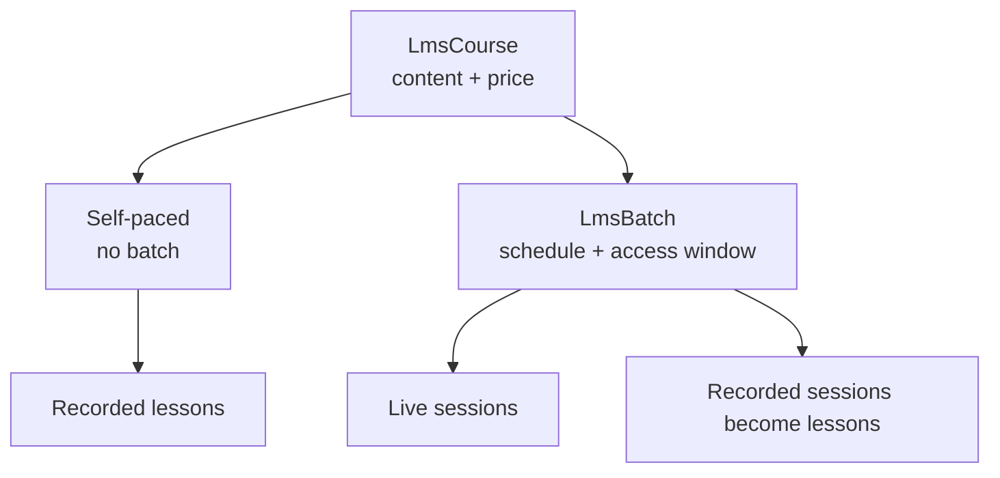

### 7.2 Lesson Types

| Type | Storage | Playback | Completion |
|---|---|---|---|
| `VIDEO` | Provider asset ID | Signed HLS | Watch threshold, default 90 percent |
| `PDF` | Private R2 key | Signed URL, PDF.js viewer | Open plus scroll threshold, or manual complete |
| `MARKDOWN` | `contentText` in DB | Server-rendered, sanitized | Manual complete or scroll threshold |
| `QUIZ` | `LmsQuiz` relation | Quiz runner | Pass score |
| `LIVE` | `LmsLiveSession` | Provider join token | Attendance threshold |
| `RECORDING` | Provider asset ID | Signed HLS | Watch threshold |

### 7.3 Access Decision Flow

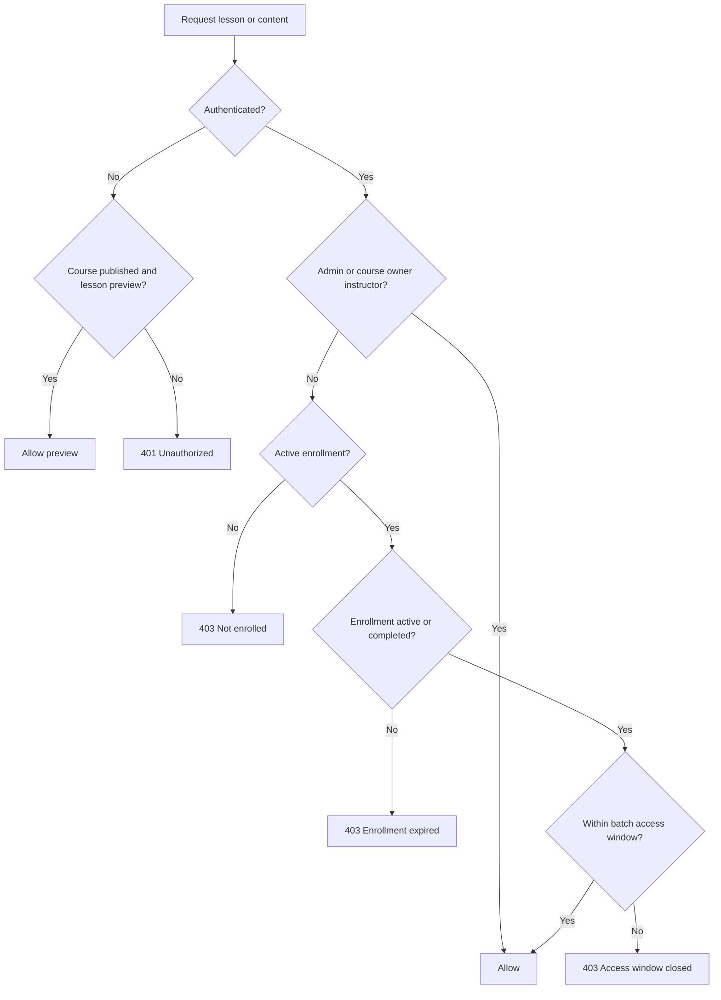

Every lesson content request, playback token request, quiz start, and live join must pass this check on the server. Do not rely on hidden UI.

### 7.4 Enrollment State Machine

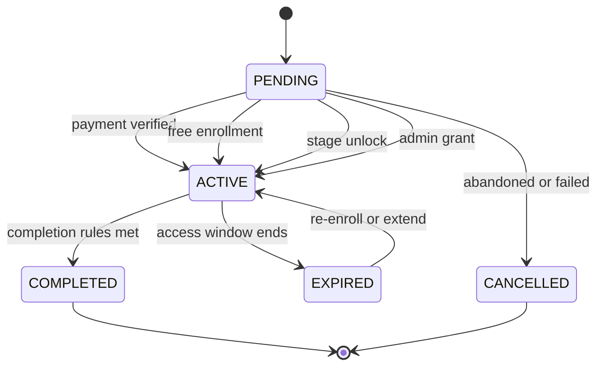

### 7.5 Course Status State Machine

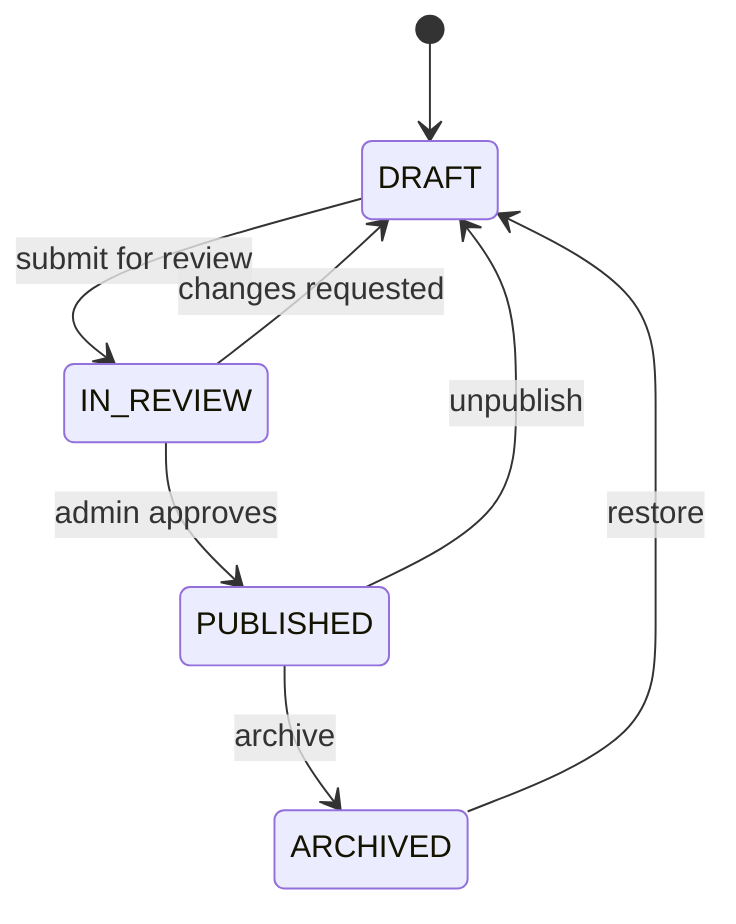

### 7.6 Order State Machine

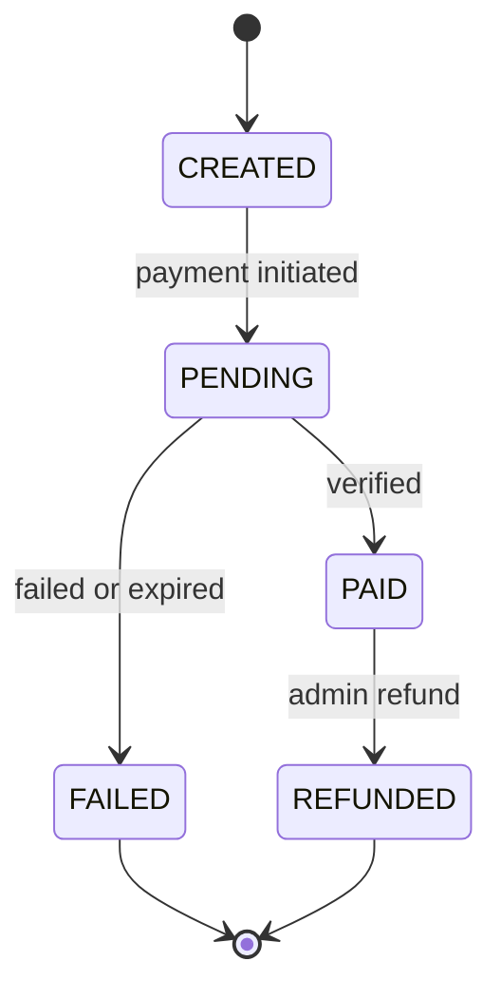

---

## 8. Core Flows

### 8.1 Student Purchase and Enrollment

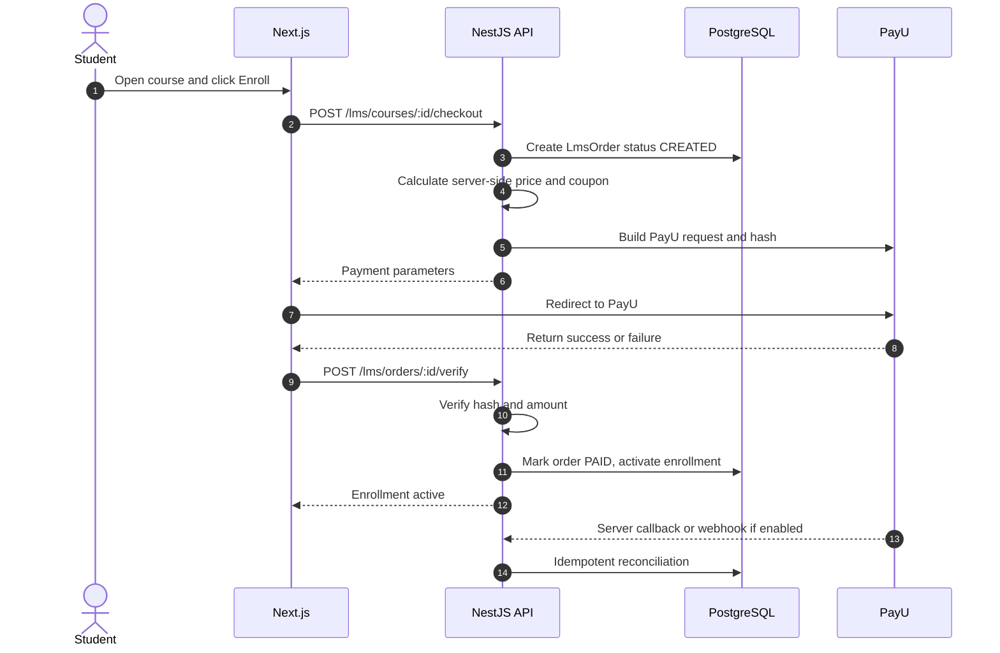

Rules:
- Price comes from the database, never the frontend.
- Enrollment activates only after server-side verification.
- Webhook and redirect must be idempotent.
- Store the provider payment ID and raw callback payload hash.
- On failure, keep the order `FAILED` and allow retry.

### 8.2 Free and Stage-Gated Enrollment

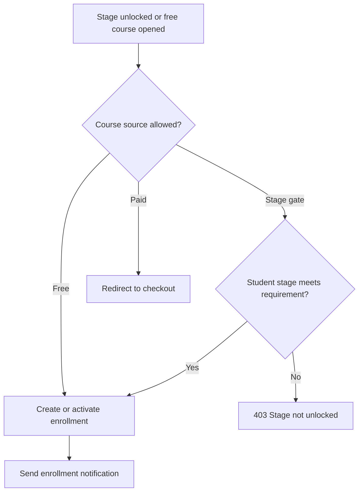

Store `LmsEnrollment.source` as `FREE`, `STAGE_UNLOCK`, `PURCHASE`, or `ADMIN_GRANT`. Do not infer access from source alone. Always check `status` and `expiresAt`.

### 8.3 Video Playback Authorization

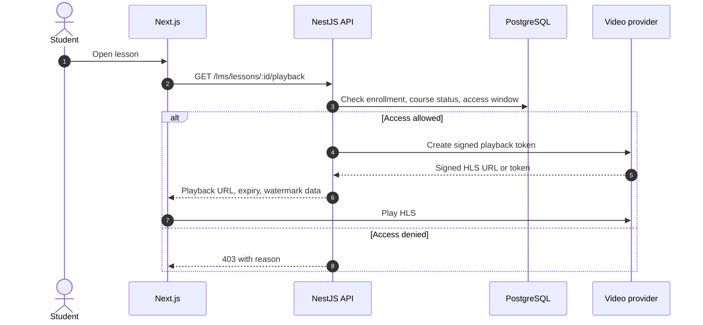

Rules:
- Playback tokens are short-lived, default 5 to 15 minutes.
- Bind tokens to user and session where the provider supports it.
- Never return provider API keys or permanent asset URLs.
- Use a moving watermark with user email or user ID.
- Enforce concurrent stream limits if the provider supports it.

### 8.4 Video Upload and Processing

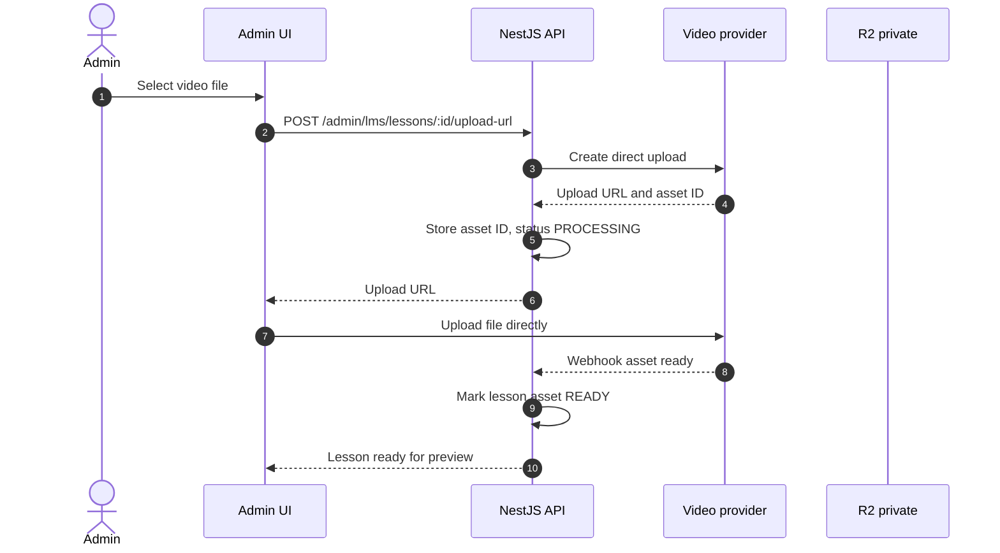

Rules:
- Do not proxy large video uploads through NestJS.
- Do not buffer lecture video in API memory.
- Store only provider asset IDs in PostgreSQL.
- Use provider webhooks to update processing status.
- PDFs and images continue to use R2 direct upload with the existing storage service.

### 8.5 Progress Tracking

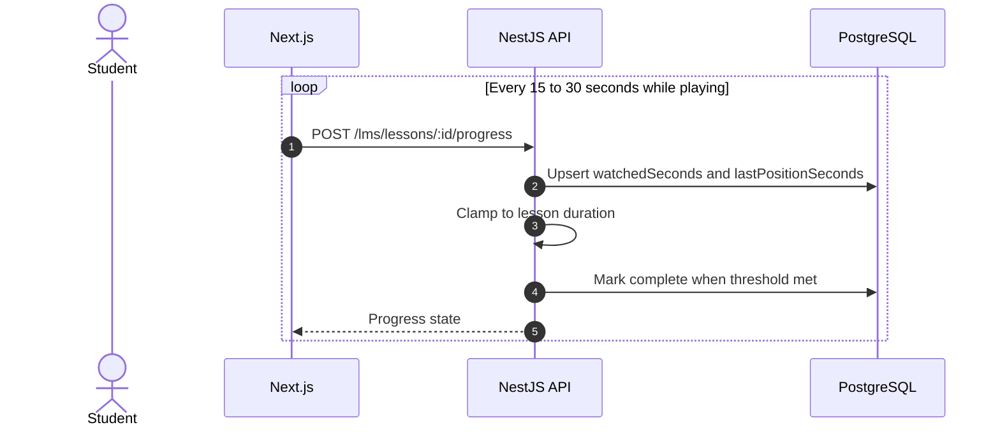

Rules:
- Do not trust localStorage for completion.
- Clamp reported position to lesson duration.
- Reject progress for lessons outside the user's enrollment.
- Use one progress row per enrollment and lesson.
- Completion threshold is configurable, default 90 percent for video.

### 8.6 Live Class Lifecycle

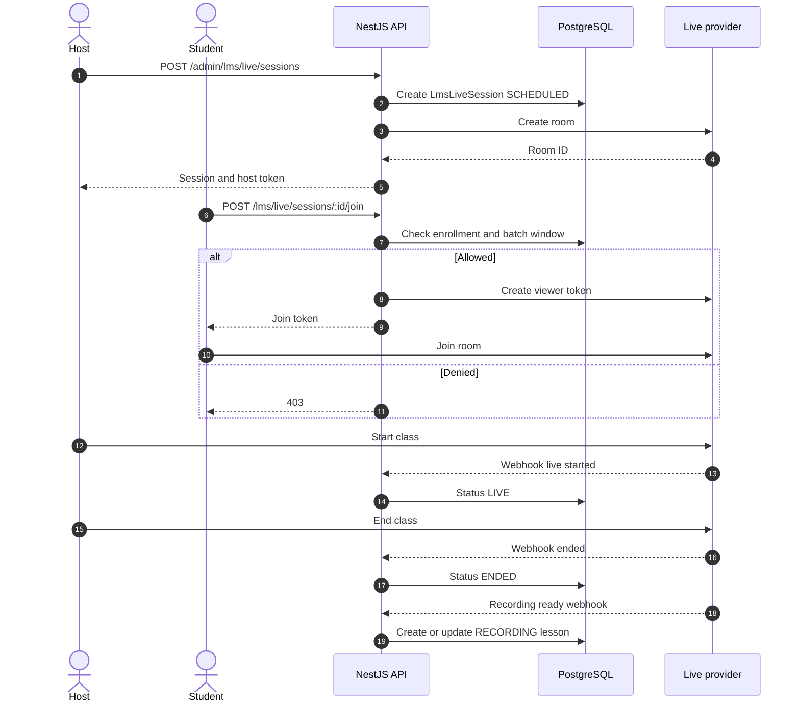

### 8.7 Recording to VOD

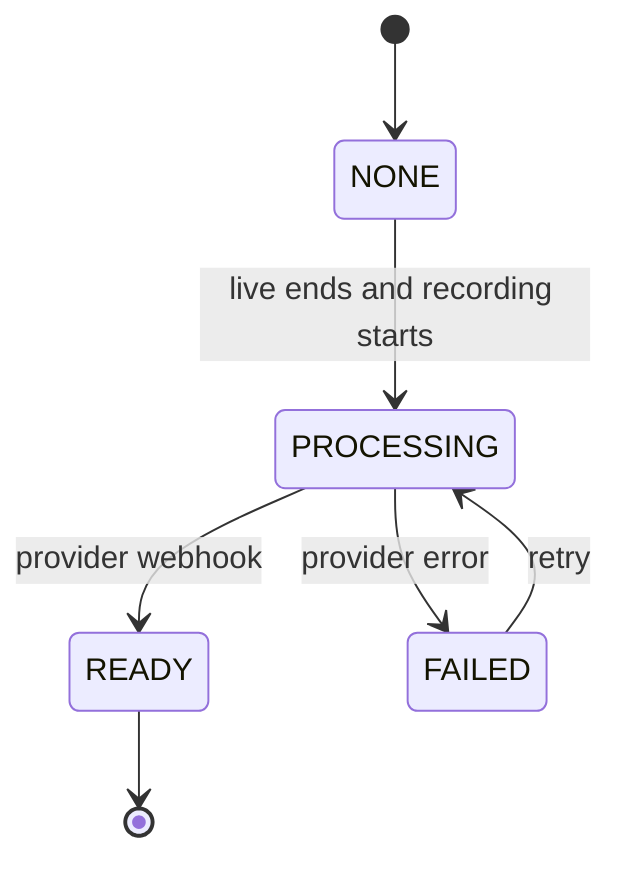

When a recording is ready:
1. Create a `RECORDING` lesson or attach the asset to an existing lesson.
2. Set `providerAssetId` and `durationSeconds`.
3. Set `status` to `ACTIVE` only after provider processing completes.
4. Notify enrolled students.
5. Keep the recording behind the same enrollment check as other lessons.

### 8.8 Quiz Attempt

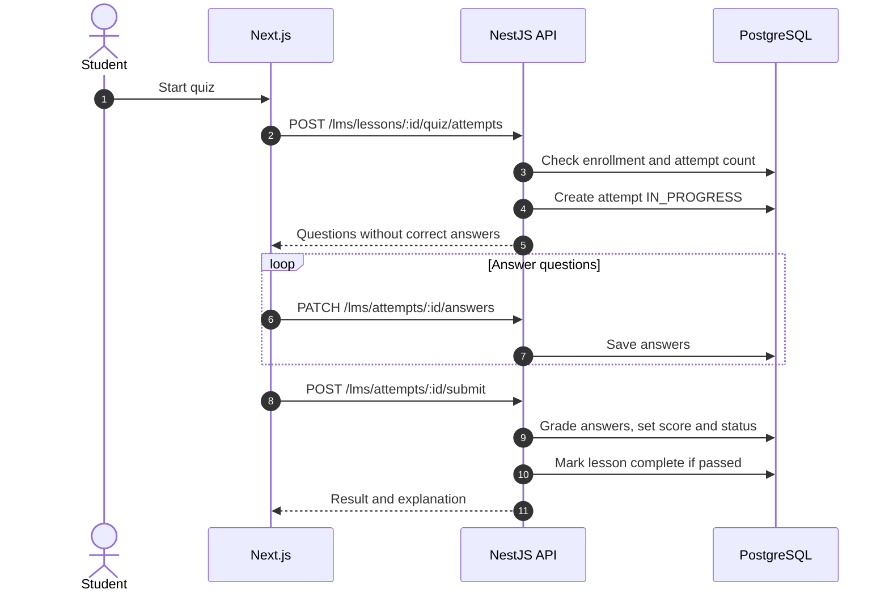

Rules:
- Never send `isCorrect` to the student before submission.
- Enforce `maxAttempts` on the server.
- Grade on the server, not in the browser.
- Expire attempts after `timeLimitMinutes`.
- Store selected option IDs for multiple choice.

### 8.9 Certificate Issuance

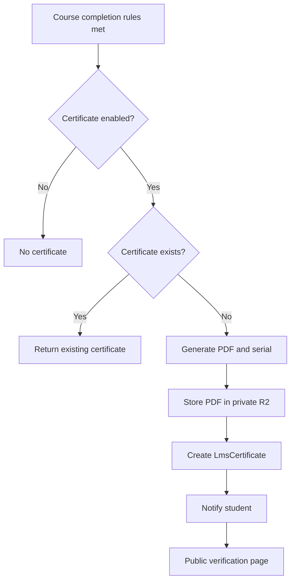

Completion rules:
- All required lessons completed.
- Required quizzes passed.
- Enrollment status is `ACTIVE` or `COMPLETED`.
- No outstanding payment or refund state.

### 8.10 Admin Authoring and Publish

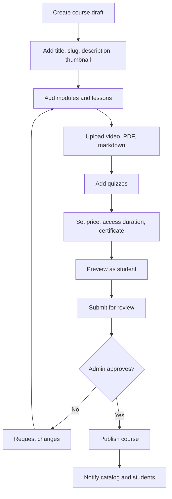

Publish checklist:
- Title, slug, description, and thumbnail present.
- At least one module and one lesson.
- At least one preview lesson.
- All video assets ready.
- Price and currency set.
- Access duration set or explicitly lifetime.
- Certificate setting set.
- Batch dates valid if batch is used.
- Live sessions scheduled if batch is live.
- SEO metadata set.
- Admin approval recorded in audit log.

### 8.11 Refund and Revoke

```mermaid
flowchart TD
  Request["Admin opens order"] --> Refund["Issue PayU refund"]
  Refund --> Verify{"Refund confirmed?"}
  Verify -- No --> Failed["Keep order PAID, log failure"]
  Verify -- Yes --> Order["Set order REFUNDED"]
  Order --> Enrollment["Set enrollment CANCELLED or EXPIRED"]
  Enrollment --> Revoke["Invalidate playback and live tokens"]
  Revoke --> Audit["Write audit log"]
  Audit --> Notify["Notify student"]
```

Refunds must be idempotent. Do not delete financial records.

---

## 9. API Design

### 9.1 Conventions

- Base path: `/lms` for LMS routes. Existing API has no global prefix.
- Auth: Bearer access token, existing refresh cookie flow.
- Public routes use `@Public()`.
- Responses use the existing envelope:
  - Success: `{ "ok": true, "data": ... }`
  - Paginated: `{ "ok": true, "data": [...], "meta": { ... } }`
  - Error: `{ "ok": false, "error": { "code": "...", "message": "...", "details": ... } }`
- Pagination: `?page=1&limit=20`.
- Idempotency: use the existing idempotency module for payment and webhook writes.
- Validation: class-validator DTOs at the API boundary.
- Authorization: role guard plus enrollment guard plus ownership check.

### 9.2 Public Routes

| Method | Route | Purpose |
|---|---|---|
| `GET` | `/lms/courses` | Published course catalog with filters |
| `GET` | `/lms/courses/:slug` | Course detail and curriculum summary |
| `GET` | `/lms/courses/:slug/preview` | Preview lessons only |
| `GET` | `/lms/certificates/verify/:serial` | Public certificate verification |

### 9.3 Student Routes

| Method | Route | Purpose |
|---|---|---|
| `GET` | `/lms/me/enrollments` | Current student's courses |
| `GET` | `/lms/me/enrollments/:id` | Enrollment detail and progress |
| `POST` | `/lms/courses/:id/enroll` | Free or stage-gated enrollment |
| `POST` | `/lms/courses/:id/checkout` | Create paid order |
| `POST` | `/lms/orders/:id/verify` | Verify payment return |
| `GET` | `/lms/lessons/:id/content` | Markdown or PDF access metadata |
| `GET` | `/lms/lessons/:id/playback` | Signed video playback token |
| `POST` | `/lms/lessons/:id/progress` | Upsert progress |
| `POST` | `/lms/lessons/:id/quiz/attempts` | Start quiz attempt |
| `PATCH` | `/lms/attempts/:id/answers` | Save answers |
| `POST` | `/lms/attempts/:id/submit` | Submit and grade |
| `GET` | `/lms/me/certificates` | Certificate list |
| `GET` | `/lms/me/certificates/:id` | Certificate download metadata |
| `POST` | `/lms/courses/:id/reviews` | Create or update review |
| `GET` | `/lms/me/live` | Upcoming live sessions |
| `POST` | `/lms/live/sessions/:id/join` | Join token for enrolled student |

### 9.4 Admin and Instructor Routes

| Method | Route | Role |
|---|---|---|
| `GET` | `/admin/lms/courses` | Admin, Instructor own |
| `POST` | `/admin/lms/courses` | Admin, Instructor |
| `GET` | `/admin/lms/courses/:id` | Admin, Instructor own |
| `PATCH` | `/admin/lms/courses/:id` | Admin, Instructor own |
| `DELETE` | `/admin/lms/courses/:id` | Admin |
| `POST` | `/admin/lms/courses/:id/submit` | Admin, Instructor own |
| `POST` | `/admin/lms/courses/:id/publish` | Admin |
| `POST` | `/admin/lms/courses/:id/archive` | Admin |
| `POST` | `/admin/lms/courses/:id/modules` | Admin, Instructor own |
| `PATCH` | `/admin/lms/modules/:id` | Admin, Instructor own |
| `DELETE` | `/admin/lms/modules/:id` | Admin, Instructor own |
| `POST` | `/admin/lms/modules/:id/lessons` | Admin, Instructor own |
| `PATCH` | `/admin/lms/lessons/:id` | Admin, Instructor own |
| `DELETE` | `/admin/lms/lessons/:id` | Admin, Instructor own |
| `POST` | `/admin/lms/lessons/:id/upload-url` | Admin, Instructor own |
| `POST` | `/admin/lms/lessons/:id/reorder` | Admin, Instructor own |
| `GET` | `/admin/lms/courses/:id/students` | Admin, Instructor own |
| `POST` | `/admin/lms/enrollments/:id/grant` | Admin |
| `POST` | `/admin/lms/enrollments/:id/revoke` | Admin |
| `GET` | `/admin/lms/orders` | Admin |
| `POST` | `/admin/lms/orders/:id/refund` | Admin |
| `GET` | `/admin/lms/reviews` | Admin |
| `POST` | `/admin/lms/reviews/:id/moderate` | Admin |
| `POST` | `/admin/lms/live/sessions` | Admin, Instructor own |
| `POST` | `/admin/lms/live/sessions/:id/start` | Admin, Instructor host |
| `POST` | `/admin/lms/live/sessions/:id/end` | Admin, Instructor host |
| `GET` | `/admin/lms/live/sessions` | Admin, Instructor own |
| `GET` | `/admin/lms/analytics/overview` | Admin |

### 9.5 Webhooks

| Method | Route | Purpose |
|---|---|---|
| `POST` | `/lms/webhooks/payu` | Payment callback, verify hash and amount |
| `POST` | `/lms/webhooks/video` | Video asset processing events |
| `POST` | `/lms/webhooks/live` | Live session and recording events |

Webhook rules:
- Verify signature or shared secret.
- Use raw request body for signature verification.
- Store event ID for idempotency.
- Return 2xx quickly, process asynchronously if needed.
- Never trust webhook payload for price or user identity without a database check.

### 9.6 Error Codes

| Code | HTTP | Meaning |
|---|---|---|
| `LMS_COURSE_NOT_FOUND` | 404 | Course missing or unpublished |
| `LMS_LESSON_NOT_FOUND` | 404 | Lesson missing |
| `LMS_NOT_ENROLLED` | 403 | User has no active enrollment |
| `LMS_ENROLLMENT_EXPIRED` | 403 | Access window ended |
| `LMS_ENROLLMENT_PENDING` | 403 | Payment not verified |
| `LMS_PAYMENT_FAILED` | 402 | Payment failed |
| `LMS_PAYMENT_VERIFICATION_FAILED` | 400 | Hash or amount mismatch |
| `LMS_LESSON_LOCKED` | 403 | Lesson is not preview and user is not enrolled |
| `LMS_QUIZ_ATTEMPT_LIMIT` | 429 | Max attempts reached |
| `LMS_QUIZ_EXPIRED` | 410 | Attempt time expired |
| `LMS_LIVE_NOT_STARTED` | 409 | Live session not open |
| `LMS_LIVE_ENDED` | 410 | Live session ended |
| `LMS_UPLOAD_NOT_READY` | 409 | Video still processing |
| `LMS_PROVIDER_ERROR` | 502 | Upstream provider failure |
| `LMS_ACCESS_DENIED` | 403 | Generic access denial |

---

## 10. UI Specification

### 10.1 Sitemap

```mermaid
flowchart TB
  Public["Public"] --> Catalog["/courses"]
  Catalog --> Detail["/courses/[slug]"]
  Detail --> Checkout["/checkout/course/[id]"]
  Detail --> Preview["Preview lesson"]
  Public --> Verify["/certificates/verify/[serial]"]

  Student["Student"] --> Learn["/student/learn"]
  Learn --> Player["/student/learn/[courseSlug]/[lessonId]"]
  Learn --> MyCertificates["/student/certificates"]
  Learn --> MyOrders["/student/orders"]
  Learn --> UpcomingLive["/student/live"]
  UpcomingLive --> LiveRoom["/student/live/[sessionId]"]

  Admin["Admin / Instructor"] --> AdminCourses["/admin/lms/courses"]
  AdminCourses --> NewCourse["/admin/lms/courses/new"]
  AdminCourses --> EditCourse["/admin/lms/courses/[id]"]
  EditCourse --> Curriculum["Curriculum tab"]
  EditCourse --> Pricing["Pricing tab"]
  EditCourse --> LiveTab["Live tab"]
  EditCourse --> StudentsTab["Students tab"]
  EditCourse --> AnalyticsTab["Analytics tab"]
  Admin --> AdminLive["/admin/lms/live"]
  Admin --> AdminOrders["/admin/lms/orders"]
  Admin --> AdminReviews["/admin/lms/reviews"]
  Admin --> AdminCoupons["/admin/lms/coupons"]
```

### 10.2 Navigation Integration

| Surface | Add |
|---|---|
| Public header | `Courses` link to `/courses` |
| Student sidebar | `My Learning`, `Live Classes`, `Certificates` |
| Student dashboard | `Continue learning` card, `Upcoming live` card, `Completed courses` count |
| Admin sidebar | `LMS` group: Courses, Live, Orders, Reviews, Coupons |
| Admin dashboard | Pending reviews, upcoming live sessions, recent orders |
| Course detail | `Already enrolled? Continue learning` state |

Do not add a separate LMS shell. Reuse the existing student and admin layouts, navigation patterns, cards, tables, and form controls.

### 10.3 Public Screens

| Screen | Purpose | Key elements | States |
|---|---|---|---|
| Course catalog | Discover courses | Search, category filter, level filter, price filter, course cards, pagination | Loading skeleton, empty, error retry |
| Course detail | Evaluate and buy | Hero, description, curriculum accordion, preview lessons, instructor, reviews, price, enroll CTA | Loading, not found, unpublished, already enrolled |
| Checkout | Complete payment | Order summary, coupon, price breakdown, PayU redirect, terms | Idle, processing, pending, failed, success, already enrolled |
| Certificate verify | Validate certificate | Serial, student name, course, issue date, valid or invalid | Valid, invalid, not found |

Course card content:
- Thumbnail.
- Title.
- Short description.
- Level and category.
- Duration.
- Lesson count.
- Rating.
- Price or Free.
- Enroll or Continue CTA.

### 10.4 Student Screens

| Screen | Purpose | Key elements | States |
|---|---|---|---|
| My learning | Resume courses | Continue learning, progress ring, upcoming live, completed courses | Loading, empty, error |
| Course player | Learn | Lesson sidebar, player, markdown or PDF viewer, quiz runner, progress, notes, watermark | Loading, buffering, locked, expired, completed, provider error |
| Certificates | Download proof | Certificate card, download, verify link | Loading, empty, error |
| Orders | Payment history | Course, amount, status, date, invoice | Loading, empty, error |
| Live list | Join classes | Upcoming, live now, past, join button | Loading, empty, live, ended |
| Live room | Attend class | Video, chat, Q&A, polls, leave, connection state | Waiting, live, reconnecting, ended, removed |

Student player layout:

```text
+--------------------------------------------------------------+
| Course title                                      Progress 42% |
+---------------------------+----------------------------------+
| Module 1                  |  Lesson title                    |
|  Lesson 1        [done]   |  +----------------------------+  |
|  Lesson 2        [current]|  | Video / PDF / Markdown     |  |
|  Lesson 3        [locked] |  | Watermark: user@email.com  |  |
| Module 2                  |  +----------------------------+  |
|  Lesson 4        [locked] |  Mark complete    Next lesson    |
+---------------------------+----------------------------------+
```

Player behavior:
- Sticky sidebar on desktop, drawer on mobile.
- Resume last position.
- Mark complete only after server confirmation.
- Show lock reason for locked lessons.
- Disable download UI.
- Show watermark overlay.
- Show transcript and captions when available.
- Keyboard shortcuts for play, pause, seek, and next lesson.
- Do not autoplay with sound.

### 10.5 Admin Screens

| Screen | Purpose | Key elements | States |
|---|---|---|---|
| Course list | Manage courses | Table, search, status filter, author, price, enrollments, publish state | Loading, empty, error |
| Course editor | Author course | Tabs: Details, Curriculum, Pricing, Live, Students, Analytics | Saving, validation error, upload progress |
| Curriculum builder | Build modules and lessons | Module list, lesson list, drag and drop, add lesson, preview | Empty, reorder saving, upload processing |
| Lesson editor | Edit lesson | Title, type, content, video upload, PDF upload, markdown editor, quiz builder, preview toggle | Uploading, processing, ready, failed |
| Pricing | Set commercial terms | Price, currency, access duration, certificate, batch price | Validation error |
| Live | Schedule classes | Session list, date, time, host, batch, status, recording status | Scheduled, live, ended, failed |
| Students | Manage enrollment | Student table, progress, last active, grant, revoke | Loading, empty, error |
| Orders | Manage payments | Order table, status, amount, student, refund | Loading, empty, refund pending |
| Reviews | Moderate feedback | Review table, rating, status, approve, reject | Loading, empty, error |
| Coupons | Manage discounts | Code, type, value, usage, active window | Loading, empty, expired |

Admin course editor layout:

```text
+--------------------------------------------------------------+
| Course: FMGE Crash Course          [Preview] [Submit] [Publish] |
+--------------------------------------------------------------+
| Details | Curriculum | Pricing | Live | Students | Analytics  |
+---------------------------+----------------------------------+
| Modules                   | Lesson editor                    |
|  1. Anatomy       [edit]  | Title: [......................]  |
|  2. Physiology    [edit]  | Type:  [Video v]                 |
|  + Add module             | Upload: [Choose file]  [Ready]   |
|                           | Preview: [x]  Order: [1]         |
|                           | [Save lesson]                    |
+---------------------------+----------------------------------+
```

### 10.6 Shared Components

| Component | Used in |
|---|---|
| `CourseCard` | Catalog, related courses |
| `CourseFilters` | Catalog |
| `CurriculumAccordion` | Course detail, preview |
| `LessonSidebar` | Player |
| `LessonPlayer` | Video playback |
| `PdfViewer` | PDF lessons |
| `MarkdownLesson` | Markdown lessons |
| `QuizRunner` | Quiz lessons |
| `ProgressRing` | My learning, course cards |
| `LockedLessonNotice` | Player |
| `CheckoutSummary` | Checkout |
| `PaymentStatus` | Checkout, orders |
| `LiveJoinCard` | Live list, course detail |
| `LiveRoom` | Live session |
| `CertificateCard` | Certificates |
| `AdminCourseTable` | Admin course list |
| `CurriculumBuilder` | Admin editor |
| `UploadDropzone` | Video, PDF, thumbnail |
| `PublishChecklist` | Admin editor |
| `OrderTable` | Admin orders |
| `ReviewModerationTable` | Admin reviews |

### 10.7 UI States

| State | Behavior |
|---|---|
| Loading | Skeleton, not spinner-only pages |
| Empty | Clear message and next action |
| Error | Retry action and support link |
| Locked | Explain why and show enroll or payment CTA |
| Pending payment | Show order status and retry |
| Expired | Show renewal or support CTA |
| Processing video | Show processing status, disable publish |
| Live starting soon | Countdown and join disabled until open |
| Live ended | Show recording if available |
| Recording processing | Show status and notify when ready |
| Completed | Show certificate CTA if enabled |

### 10.8 Responsive and Accessibility

- Student screens are mobile-first. Admin screens are desktop-first.
- Player sidebar becomes a drawer on mobile.
- Tables become cards on mobile for student screens.
- Admin tables may scroll horizontally on small screens.
- All controls keyboard accessible.
- Focus states visible.
- Contrast meets WCAG AA where practical.
- Captions and transcripts for video when available.
- No autoplay with sound.
- Respect reduced motion.
- Error messages are specific and human.
- Do not rely on color alone for status.

---

## 11. Security

### 11.1 Threat Model

| Threat | Impact | Control | Residual risk |
|---|---|---|---|
| Shared playback URL | Free access | Short-lived signed tokens, user binding | Token can be shared before expiry |
| Direct download | Content leak | HLS plus DRM where available, no public bucket | Determined user can download segments |
| Screen recording | Content leak | Watermark, forensic watermark, legal terms | Cannot be prevented on web |
| Account sharing | Lost revenue | Device and concurrent stream limits, anomaly detection | Shared credentials still work |
| PDF sharing | Content leak | Signed URL, watermark, no public bucket | Screenshot and re-upload possible |
| Live class recording | Privacy and revenue leak | Host-only recording, viewer recording disabled, watermark | OBS and external capture possible |
| IDOR | Unauthorized access | Enrollment guard on every request, ownership checks | Bugs if guard omitted |
| Role escalation | Admin compromise | RolesGuard, least privilege, audit logs | Misconfigured route |
| Payment tampering | Revenue loss | Server-side price, hash verification, webhook idempotency | Callback replay if not idempotent |
| Webhook forgery | Fake enrollment | Signature verification, shared secret | Secret leak |
| Refund abuse | Revenue loss | Admin-only refunds, audit, provider confirmation | Manual error |

### 11.2 Video Protection

Layers, strongest first:

1. DRM: Widevine, FairPlay, or PlayReady through a provider that supports it.
2. Signed HLS playback tokens, short TTL, bound to user and session.
3. Per-user visible watermark and forensic watermark where supported.
4. Concurrent stream and device limits.
5. Disable download UI and right-click, but do not treat this as security.
6. Audit playback token issuance and anomaly detection.
7. Takedown process for leaked content.

Recommended posture:
- Start with Cloudflare Stream signed playback plus watermark.
- Move to Mux DRM or Vimeo Enterprise DRM only if piracy data justifies the cost.
- Never serve paid video from a public R2 URL or a raw MP4 link.

### 11.3 PDF and Markdown Protection

- Store PDFs in a private R2 bucket.
- Use short-lived signed URLs, default 5 minutes.
- Render PDFs in an application viewer with a watermark overlay.
- Disable the download button in the UI.
- Do not expose the R2 object key to the client unless it is already signed.
- Markdown is stored as text and rendered server-side with sanitization.
- Do not allow raw HTML in markdown unless it comes from a trusted admin.
- Accept that screenshots and browser cache can still leak PDFs.

### 11.4 Live Class Protection

- Issue join tokens only to enrolled students.
- Use host and viewer roles with different permissions.
- Disable participant recording and screen sharing by default.
- Use a waiting room or host approval for sensitive classes.
- Record on the provider side only.
- Add a visible watermark with student identity.
- Track join and leave events for attendance.
- Require consent notice for recording.
- Accept that external screen capture cannot be prevented.

### 11.5 Payment Security

- Price is calculated on the server from `LmsCourse` or `LmsBatch`.
- Never trust amount, currency, or course ID from the client without validation.
- Verify PayU hash and amount before activating enrollment.
- Store provider payment ID and order ID.
- Make callback and webhook handlers idempotent.
- Do not delete orders on failure.
- Refunds are admin-only and audited.
- Reconcile daily with PayU settlement reports.

### 11.6 Authorization Rules

- Every lesson content request checks enrollment.
- Every playback token request checks enrollment and access window.
- Every live join checks enrollment and session status.
- Every admin route checks role.
- Every instructor route checks ownership.
- Every quiz submission checks enrollment and attempt ownership.
- Every certificate download checks ownership.
- Every order and refund checks ownership or admin role.
- Never rely on frontend route guards alone.

### 11.7 Audit and Rate Limits

Audit these actions:
- Course create, update, submit, publish, archive.
- Lesson create, update, delete, reorder.
- Video upload and asset ready.
- Enrollment grant and revoke.
- Order create, verify, refund.
- Live session create, start, end.
- Review moderation.
- Certificate issue and reissue.
- Provider configuration changes.

Rate limit:
- Login and OTP: existing limits.
- Playback token: per user and IP.
- Progress heartbeat: per user and lesson.
- Quiz submit: per attempt.
- Checkout: per user.
- Webhooks: per provider and event ID.

---

## 12. Notifications

| Event | Channel | Recipient |
|---|---|---|
| Enrollment activated | Email, in-app | Student |
| Payment failed | Email, in-app | Student |
| Live class scheduled | Email, push | Enrolled students |
| Live class starting in 1 hour | Push, email | Enrolled students |
| Live class started | Push | Enrolled students |
| Recording ready | Email, in-app | Enrolled students |
| Quiz passed | In-app | Student |
| Certificate issued | Email, in-app | Student |
| Course expiring soon | Email, in-app | Student |
| Refund processed | Email, in-app | Student |
| Review approved or rejected | In-app | Student |
| New enrollment | In-app | Admin or instructor |

Reuse the existing notification service. Do not build a second notification system.

---

## 13. Analytics

V1 admin analytics:
- Catalog views.
- Course detail views.
- Checkout starts.
- Successful purchases.
- Enrollment count.
- Active learners.
- Lesson completion rate.
- Average watch time.
- Quiz pass rate.
- Live attendance rate.
- Certificate issue count.
- Revenue and refunds.

Use PostgreSQL queries and the existing admin dashboard patterns. Do not add Mixpanel or Amplitude in V1.

---

## 14. Compliance and Data Handling

- Payment card data stays with PayU. Do not store card data.
- Record live classes only with a consent notice.
- Define recording retention. Default proposal: 12 months, configurable.
- Define certificate retention. Default proposal: 7 years.
- Support data export and deletion requests where legally required.
- Anonymize users instead of hard deleting financial records.
- Do not store real patient data in course content.
- Confirm content licensing for medical images, videos, and PDFs.
- Follow Indian DPDP Act requirements and GDPR where applicable.
- Keep provider data processing agreements.

This section is not legal advice. Have counsel review before launch.

---

## 15. Provider Choices

| Need | Recommended | Alternative | Avoid |
|---|---|---|---|
| Recorded video | Cloudflare Stream | Mux, Vimeo Enterprise | Public R2 MP4, self-hosted transcoding |
| Strong DRM | Mux DRM or Vimeo Enterprise | Provider-specific DRM | Pretending signed URLs are DRM |
| Live classes | LiveKit Cloud | Agora | Building a WebRTC SFU |
| Low-cost live fallback | Jitsi | Self-hosted LiveKit | Paid-scale Jitsi without testing |
| PDF and images | Cloudflare R2 | S3 | Public bucket |
| Payments | PayU | Razorpay if migrated later | Frontend-only payment confirmation |
| Search | PostgreSQL full-text | None in V1 | Algolia or Elasticsearch in V1 |
| Analytics | PostgreSQL plus admin UI | None in V1 | Mixpanel in V1 |

Provider adapter contract:

| Adapter | Required methods |
|---|---|
| `VideoProvider` | `createDirectUpload`, `getAsset`, `createPlaybackToken`, `deleteAsset`, `verifyWebhook` |
| `LiveProvider` | `createRoom`, `createJoinToken`, `startRecording`, `stopRecording`, `getRecording`, `verifyWebhook` |
| `PaymentProvider` | `createOrder`, `verifyCallback`, `refund` |
| `StorageProvider` | `getSignedUrl`, `putObject`, `deleteObject` |

---

## 16. Phased Delivery

### Phase 1: Foundation

Deliver:
- Prisma `Lms*` schema and migration.
- `LmsModule` registered in `AppModule`.
- Course, module, lesson CRUD.
- Admin course list and editor shell.
- Public catalog and course detail.
- Enrollment model and access guard.
- PDF and markdown lessons.
- Basic progress tracking.

Exit criteria:
- Admin can create a draft course with modules and lessons.
- Student can view published catalog and preview lessons.
- Access guard blocks non-enrolled lessons.
- PDF and markdown render.
- Progress persists.

### Phase 2: Commerce and Video

Deliver:
- PayU course order flow.
- Free and stage-gated enrollment.
- Direct video upload adapter.
- Signed playback tokens.
- Video player with resume.
- Watermark overlay.
- Admin upload status.

Exit criteria:
- Student can buy a course and access it.
- Student cannot access without enrollment.
- Playback token expires.
- Video upload does not pass through NestJS.
- Admin can preview uploaded video.

### Phase 3: Live Classes

Deliver:
- Live provider adapter.
- Session scheduling.
- Host and viewer join tokens.
- Attendance tracking.
- Recording webhook.
- Recording to VOD lesson.
- Student live list and live room.

Exit criteria:
- Admin can schedule and start a live class.
- Enrolled student can join.
- Non-enrolled student is blocked.
- Recording appears as a lesson after processing.
- Attendance is recorded.

### Phase 4: Quizzes and Certificates

Deliver:
- Quiz builder.
- Quiz runner.
- Server-side grading.
- Attempt limits and timer.
- Completion rules.
- Certificate PDF and verification page.
- Notifications.

Exit criteria:
- Student can take a quiz.
- Correct answers are not exposed before submit.
- Passing quiz updates progress.
- Certificate is issued once and verifiable.

### Phase 5: Polish

Deliver:
- Reviews and moderation.
- Coupons.
- Admin analytics.
- Refund and revoke flow.
- Audit coverage.
- Rate limits.
- Accessibility pass.
- Load testing.

Exit criteria:
- Admin can refund and revoke access.
- Reviews are moderated.
- Analytics show enrollment and completion.
- Security tests pass.

---

## 17. Testing Strategy

| Layer | Tests |
|---|---|
| Unit | Access guard, enrollment state, order state, progress clamping, quiz grading, certificate eligibility |
| Integration | PayU callback, video webhook, live webhook, enrollment activation, playback token |
| E2E | Browse, buy, enroll, play, progress, quiz, certificate |
| Security | IDOR, expired token, role escalation, webhook forgery, replay, rate limits |
| Load | Catalog, playback token, progress heartbeat, live join |
| Provider | Sandbox upload, playback, recording, refund |

Minimum regression checks:
- Non-enrolled user cannot fetch playback token.
- Expired enrollment cannot fetch playback token.
- Correct quiz answers are absent before submit.
- Payment amount cannot be changed by client.
- Refund revokes access.
- Admin publish writes audit log.

---

## 18. Acceptance Criteria

### Student

- Can browse published courses.
- Can preview allowed lessons.
- Can buy a paid course with PayU.
- Can enroll in a free or stage-gated course.
- Can access only enrolled content.
- Can resume video from last position.
- Can read PDF and markdown lessons.
- Can take quizzes and see results.
- Can download a certificate after completion.
- Can join live classes when enrolled.
- Sees clear states for locked, pending, expired, and completed.

### Admin

- Can create, edit, submit, publish, and archive courses.
- Can add, reorder, and delete modules and lessons.
- Can upload video, PDF, and thumbnail assets.
- Can schedule live classes and see recording status.
- Can view enrollments, progress, orders, and revenue.
- Can grant and revoke enrollment.
- Can refund orders.
- Can moderate reviews.
- Can see audit logs for sensitive actions.

### Security

- No public bucket URL for paid content.
- No permanent video URL in the client.
- Playback token is short-lived and enrollment-bound.
- Live join token is enrollment-bound.
- Payment verification is server-side.
- Webhooks are signature-verified and idempotent.
- Admin routes enforce role and ownership.
- Sensitive actions are audited.
- Security limitations are documented in the student terms.

---

## 19. Risks

| Risk | Mitigation |
|---|---|
| Provider lock-in | Adapter interfaces, store provider-neutral IDs |
| Video cost growth | CDN, lifecycle rules, archival, usage alerts |
| Piracy | DRM where justified, watermark, concurrency limits, takedown |
| Live class disruption | Provider status monitoring, fallback provider, recording |
| Payment mismatch | Webhook plus daily reconciliation |
| Scope creep into marketplace | Explicit non-goals, admin-owned content in V1 |
| Schema confusion with legacy courses | `Lms*` prefix, do not reuse `Course` or `Section` |
| Instructor role complexity | Admin-only authoring in V1 |
| Offline download conflict | No offline in V1 |
| Medical content accuracy | Subject expert review before publish |
| Legal exposure from recordings | Consent notice, retention policy, counsel review |

---

## 20. Open Questions

| Question | Default answer |
|---|---|
| Will courses be sold individually or as subscriptions? | Individually in V1 |
| Will live classes be cohort-based? | Yes, use `LmsBatch` |
| Will external instructors author content? | No in V1, add `INSTRUCTOR` later |
| Is DRM required at launch? | No, start with signed playback and watermark |
| Are SCORM packages required? | No |
| Is offline download required? | No |
| Will parents view progress? | Later |
| Will there be coupons at launch? | No, Phase 5 |
| Will there be instructor payouts? | No |
| Which video provider is final? | Cloudflare Stream unless DRM is approved |

---

## Appendix A: Environment Variables

| Variable | Purpose |
|---|---|
| `LMS_ENABLED` | Feature flag |
| `LMS_VIDEO_PROVIDER` | `CLOUDFLARE_STREAM`, `MUX`, or `VIMEO` |
| `LMS_LIVE_PROVIDER` | `LIVEKIT` or `AGORA` |
| `CLOUDFLARE_STREAM_ACCOUNT_ID` | Cloudflare Stream account |
| `CLOUDFLARE_STREAM_API_TOKEN` | Cloudflare Stream API token |
| `CLOUDFLARE_STREAM_SIGNING_KEY_ID` | Playback signing key ID |
| `CLOUDFLARE_STREAM_SIGNING_KEY` | Playback signing key |
| `MUX_TOKEN_ID` | Mux API token ID |
| `MUX_TOKEN_SECRET` | Mux API token secret |
| `MUX_SIGNING_KEY_ID` | Mux playback signing key ID |
| `MUX_SIGNING_PRIVATE_KEY` | Mux playback signing private key |
| `LIVEKIT_URL` | LiveKit WebSocket URL |
| `LIVEKIT_API_KEY` | LiveKit API key |
| `LIVEKIT_API_SECRET` | LiveKit API secret |
| `AGORA_APP_ID` | Agora app ID |
| `AGORA_APP_CERTIFICATE` | Agora app certificate |
| `R2_ACCOUNT_ID` | Existing R2 account |
| `R2_ACCESS_KEY_ID` | Existing R2 access key |
| `R2_SECRET_ACCESS_KEY` | Existing R2 secret |
| `R2_BUCKET_NAME` | Private bucket |
| `PAYU_KEY` | Existing PayU key |
| `PAYU_SALT` | Existing PayU salt |
| `PAYU_BASE_URL` | Existing PayU base URL |
| `DATABASE_URL` | Existing Neon connection |
| `REDIS_URL` | Existing Redis connection |

Only one video provider and one live provider should be active per environment. Keep secrets server-side.

---

## Appendix B: Glossary

| Term | Meaning |
|---|---|
| Course | Sellable content container |
| Batch | Scheduled offering of a course |
| Module | Chapter or section |
| Lesson | Smallest learning unit |
| Enrollment | User's right to access a course |
| Order | Payment attempt |
| Progress | Per-lesson watch and completion state |
| Live session | Scheduled real-time class |
| Recording | VOD asset created from a live session |
| Certificate | Verifiable completion record |
| DRM | Digital rights management, encrypted playback |
| HLS | HTTP Live Streaming |
| Signed URL | Time-limited URL with a signature |
| Watermark | Visible or forensic identity mark |
| IDOR | Insecure direct object reference |

---

## Appendix C: Implementation Checklist

- [ ] Add `Lms*` Prisma schema.
- [ ] Add `User` and `University` relations.
- [ ] Add `INSTRUCTOR` role only if needed.
- [ ] Register `LmsModule` in `AppModule`.
- [ ] Add feature flag `LMS_ENABLED`.
- [ ] Add course, module, lesson CRUD.
- [ ] Add access guard and tests.
- [ ] Add public catalog and detail.
- [ ] Add admin course editor.
- [ ] Add PDF and markdown lessons.
- [ ] Add PayU order flow.
- [ ] Add video provider adapter and direct upload.
- [ ] Add playback token endpoint.
- [ ] Add progress heartbeat.
- [ ] Add live provider adapter and session scheduling.
- [ ] Add attendance and recording webhook.
- [ ] Add quiz builder and runner.
- [ ] Add certificate generation and verification.
- [ ] Add notifications.
- [ ] Add audit logs.
- [ ] Add rate limits.
- [ ] Add security tests.
- [ ] Add load tests.
- [ ] Add student terms and recording consent.
- [ ] Add provider usage alerts.
- [ ] Add daily payment reconciliation.

---

**End of specification.**
